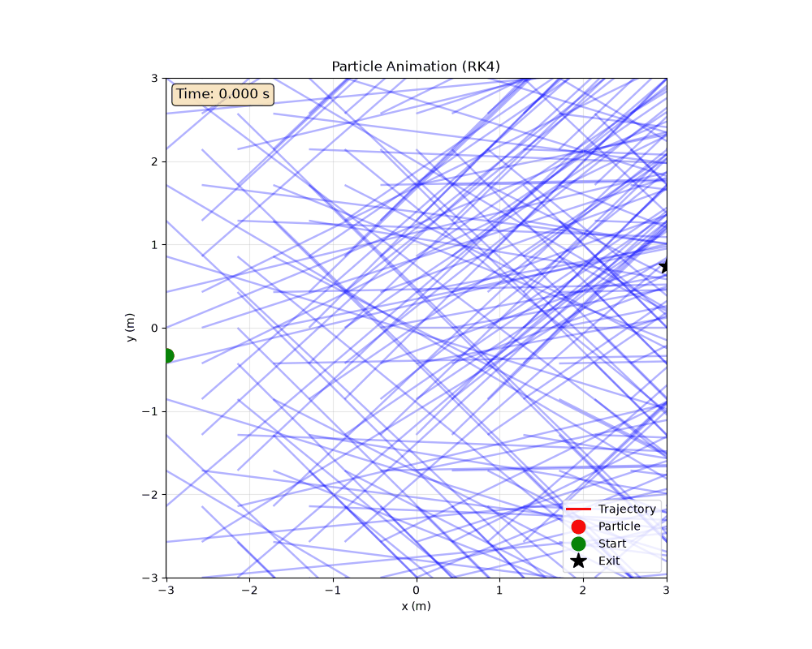

# Lagrangian Particle Tracking Simulation


A modular Python application for simulating particle trajectories in a 2D fluid using Forward Euler and Classical RK4 integration methods.


<div class="animation" align="center">
  </img> 
</div>
## Features

- **Two integration methods**: Forward Euler and Classical 4th-order Runge-Kutta (RK4)
- **Physical model**: Particle moving through fluid with drag and buoyancy/gravity forces
- **Data persistence**: CSV files for simulation results, JSON for metadata
- **Visualization**: Static plots (fluid field, trajectories, method comparison)
- **Animation**: Optional particle trajectory animation (GIF)
- **Excel export**: Comprehensive workbook with parameters, timestep data, and comparison
- **Modular architecture**: Separate modules for physics, integrators, simulation, data, visualization, animation, and export

## Installation

```bash
# Create virtual environment
python -m venv .venv
source .venv/bin/activate  # Linux/Mac
# .venv\Scripts\activate   # Windows

# Install dependencies
pip install -r requirements.txt
```

Or using uv:
```bash
uv pip install -r requirements.txt
```

## Dependencies

- numpy >= 2.5.3
- pandas >= 3.0.6
- matplotlib >= 3.11.2
- openpyxl >= 3.1.5
- pytest >= 9.1.1 (for testing)

## Configuration

The key configurable parameter is **Z** (the last digit of your roll number), which determines gravity:
- `g_y = 2 * (Z - 5) m/s²`
- Initial y position: `y = -(g_y + 1) / 3`

Other parameters:
- Particle radius: `r_p = 0.01 m`
- Particle density: `ρ_p = 100 kg/m³`
- Fluid density: `ρ_f = 1000 kg/m³`
- Drag coefficient: `C_D = 0.3`
- Domain: `-3 ≤ x ≤ 3`, `-3 ≤ y ≤ 3`
- Default timestep: `dt = 0.001 s`

## Usage

### Run Simulation

```bash
# Run both Euler and RK4 (default)
python -m src.main --Z 5 simulate --method both

# Run only Euler
python -m src.main --Z 5 simulate --method euler

# Run only RK4
python -m src.main --Z 5 simulate --method rk4

# Custom timestep and simulation time
python -m src.main --Z 5 --dt 0.001 --t-max 100 simulate --method both
```

### Visualize Existing Results

```bash
# Generate plots from saved CSV files (no simulation run)
python -m src.main --Z 5 visualize
```

### Create Animation

```bash
# Create and save animation (GIF)
python -m src.main --Z 5 animate --method rk4 --save

# Custom frame skip for faster rendering
python -m src.main --Z 5 animate --method rk4 --save --frame-skip 20
```

### Export to Excel

```bash
# Generate Excel workbook from saved results
python -m src.main --Z 5 export
```

## Output Files

```
output/
├── euler_results.csv          # Euler timestep data
├── rk4_results.csv            # RK4 timestep data
├── euler_metadata.json        # Euler simulation metadata
├── rk4_metadata.json          # RK4 simulation metadata
├── simulation_summary.json    # Combined summary
├── particle_tracking_results.xlsx  # Excel workbook
├── flow_and_trajectory.png    # Main assignment plot
├── method_comparison.png      # Euler vs RK4 comparison
├── velocity_comparison.png    # Velocity over time
├── euler_trajectory.png       # Euler trajectory plot
├── rk4_trajectory.png         # RK4 trajectory plot
└── particle_animation_rk4.gif # Optional animation
```

## Project Structure

```
project/
├── main.py              # Command-line interface
├── requirements.txt     # Python dependencies
├── README.md           # This file
├── .gitignore
├── src/
│   ├── __init__.py
│   ├── config.py       # Configuration parameters
│   ├── physics.py      # Physical model calculations
│   ├── integrators.py  # Euler and RK4 implementations
│   ├── simulation.py   # Simulation loop
│   ├── data.py         # CSV/JSON persistence
│   ├── visualization.py # Static plots
│   ├── animation.py    # Matplotlib animation
│   └── export.py       # Excel workbook generation
├── tests/
│   ├── __init__.py
│   ├── test_physics.py
│   ├── test_integrators.py
│   └── test_data.py
└── output/             # Generated files (created automatically)
```

## Physical Model

### Fluid Velocity Field
```
u_fluid = (1, sin(x² + y²))
```

### Forces
- **Drag**: `F_drag = 0.5 * C_D * ρ_f * π * r_p² * |u_rel| * u_rel`
- **Buoyancy/Gravity**: `F_buoyancy = (ρ_f - ρ_p) * (4/3) * π * r_p³ * g_vector`
  - Uses `(ρ_f - ρ_p)` as per assignment convention
  - `g_vector = (0, g_y)` where `g_y = 2*(Z-5)`

### Integration
- **State**: `[x, y, u_x, u_y]`
- **Derivative**: `[u_x, u_y, a_x, a_y]`
- **Forward Euler**: `state_next = state + dt * f(t, state)`
- **RK4**: Classical 4-stage method

### Termination
Simulation stops when particle leaves domain `[-3, 3] × [-3, 3]`, or reaches max time/steps.

## Running Tests

```bash
python -m pytest tests/ -v
```

## Important Notes

1. **Visualization/Animation/Export are independent**: These commands only load saved CSV files and do NOT re-run the simulation.
2. **Z value must be consistent**: Use the same `--Z` value for all commands to ensure correct initial conditions.
3. **Animation performance**: Large simulations create many frames. Use `--frame-skip` (default 20) to reduce frames.
4. **GIF saving requires pillow**: Install with `pip install pillow` if not already available.
5. **Excel export requires openpyxl**: Included in requirements.txt.

## Example Workflow

```bash
# 1. Run simulation with your roll number's last digit (e.g., Z=7)
python -m src.main --Z 7 simulate --method both

# 2. View the generated plots
python -m src.main --Z 7 visualize

# 3. Create animation
python -m src.main --Z 7 animate --method rk4 --save

# 4. Export to Excel for reporting
python -m src.main --Z 7 export

# 5. Check output files
ls output/
```
